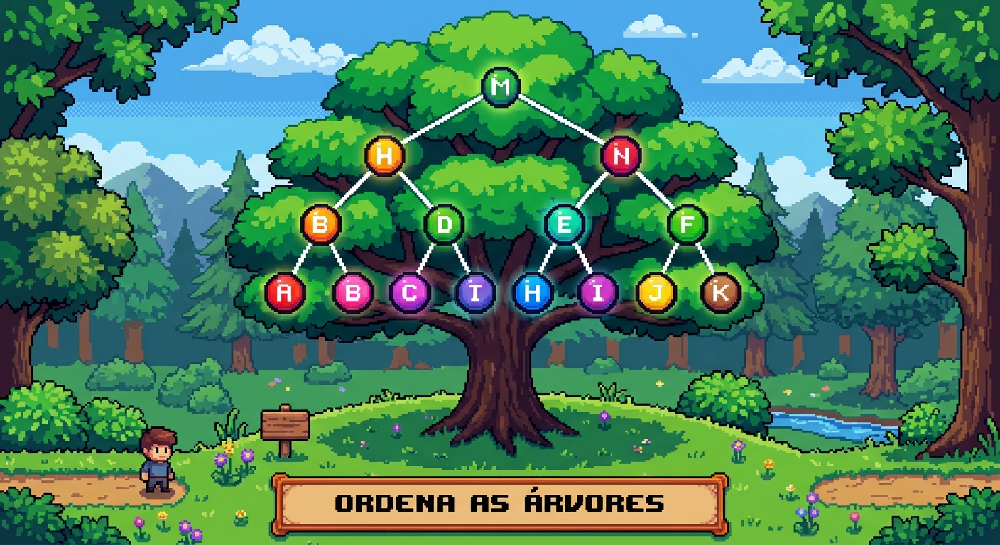
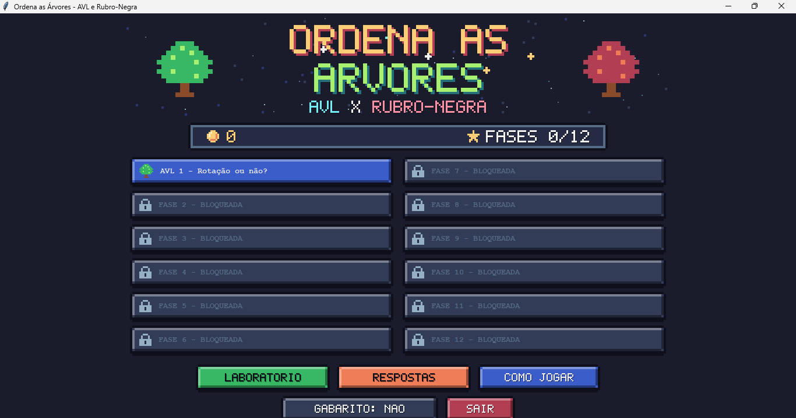
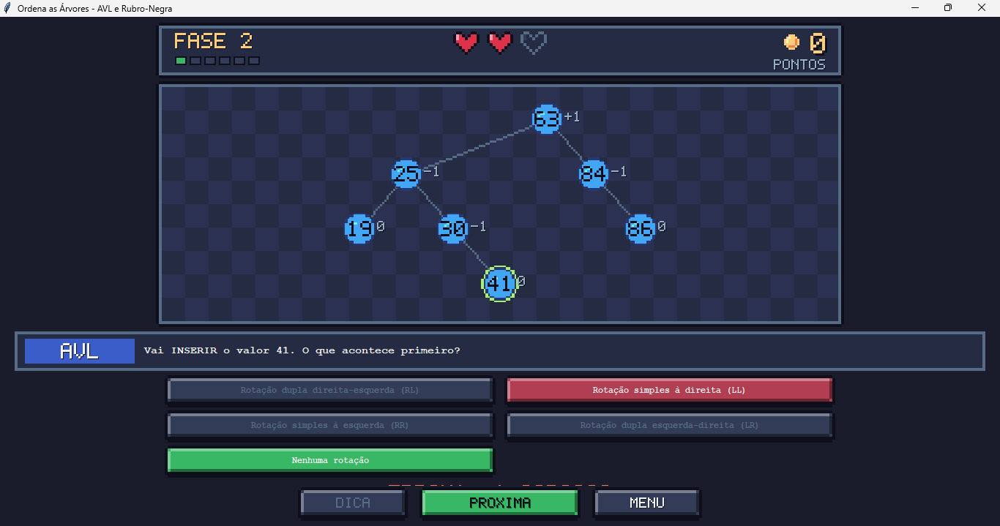
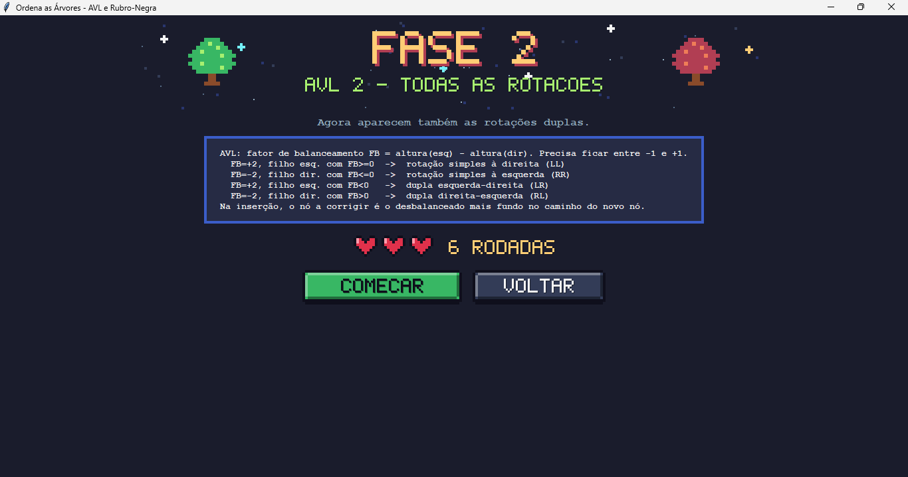
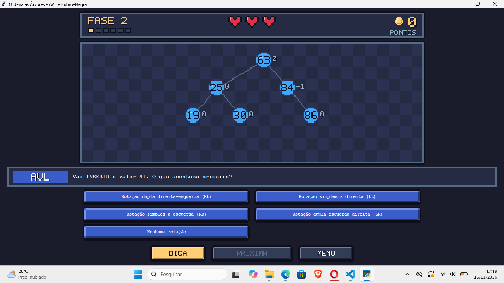

# Ordena as arvores



---

## Autor

| Matrícula | Aluno |
| :---: | :--- |
| **221007715** | Fernanda Santos |

---

## Sobre o Projeto
**Ordena as Árvores** é um jogo educativo em Python para praticar inserção e remoção em árvores AVL e Rubro-Negra. Possui **12 níveis progressivos**, incluindo o modo **Chefão**, além de um **Laboratório Livre** para testar operações e acompanhar o comportamento das duas árvores.


> [!IMPORTANT]
> **Nota:** as perguntas são geradas aleatoriamente a cada rodada, então cada partida é diferente.


---

## Como Executar

### Requisitos
* Python 3 com **tkinter** (já incluso na instalação padrão do Python no Windows e no macOS).
* No Linux, caso falte o tkinter: `sudo apt install python3-tk`.

### Iniciar o Jogo
Navegue até a pasta raiz do projeto e execute:

```bash
python ordenaasarvores.py
```


---

## Algoritmos e Estruturas de Dados

O projeto implementa duas árvores binárias de busca auto-balanceadas, ambas registrando cada rotação e recoloração para que o jogo possa gerar perguntas e explicações.


---

## Capturas de Tela













---


## Vídeo Demonstrativo

<p align="center">
  <a href="https://www.youtube.com/watch?v=RsuQQGFl8jc" target="_blank">
    
  </a>
</p>
